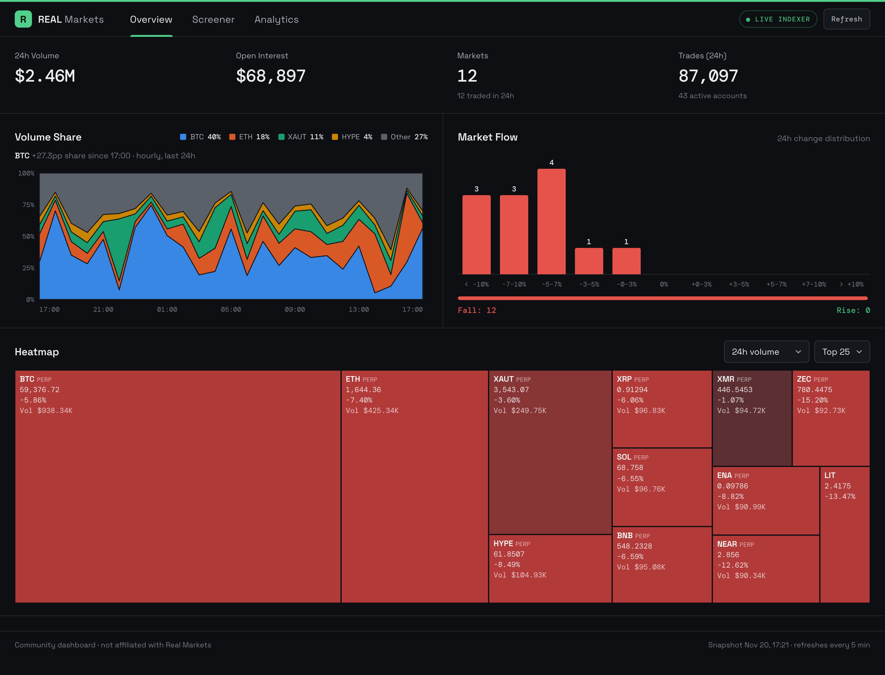
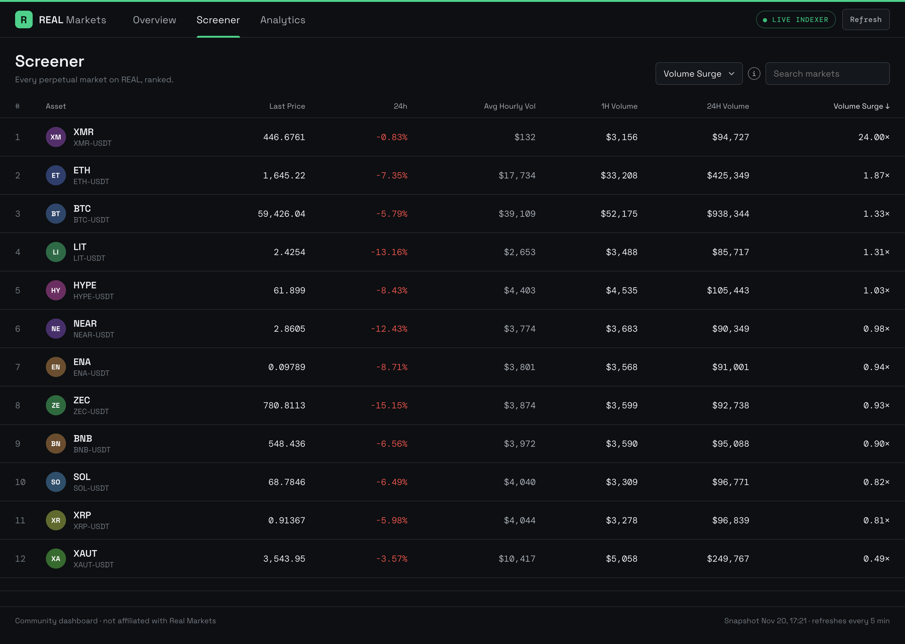
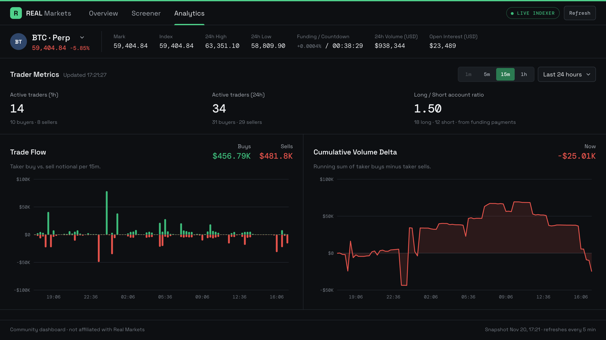

<div align="center">

# REAL Markets Dashboard

**Every REAL perpetual market at a glance: live, open source, and built entirely on the public indexer.**

[](https://github.com/Hug0x0/real-markets-dashboard/actions/workflows/ci.yml)


[](LICENSE)



</div>

---

## Why this exists

REAL's indexer exposes everything a trader needs, but only as raw fills and ticker snapshots. Nothing shows the exchange as a whole: where volume is moving, which markets are waking up, or who is buying versus selling.

This dashboard fills that gap. It works like the market pages traders already use on other perp venues, and it runs on **REAL's own public API alone**. There is no backend, no API key and no database, so anyone can open it, fork it or host it.

- **One-glance health of the exchange:** volume, open interest, breadth and market share, all on one screen.
- **Early signals:** the screener ranks markets by how unusual the last hour is compared to the rest of the day.
- **Order-flow depth per market:** taker buy/sell flow, cumulative volume delta, active traders and the long/short account split.
- **Fast:** first content in about 1 second, the full 24h of history in about 7 seconds, and near-instant reloads from a local cache.

## A tour of the three views

### Overview

This is the screenshot at the top of this page.

| Panel | What it shows |
| --- | --- |
| **KPIs** | 24h volume, open interest, number of markets, and 24h trades with active accounts. |
| **Volume share** | Hourly share of traded notional for the top 4 markets, with the rest grouped as Other. Hover for exact values. |
| **Market flow** | Histogram of 24h price changes, plus a fall/rise breadth bar. |
| **Heatmap** | One tile per market, sized by 24h volume or open interest and coloured by 24h change. Click a tile to open that market. |

### Screener



Every market, ranked by **volume surge** (last hour versus the hourly average), 24h change, 24h volume, open interest, funding rate or 24h trade count. You can search markets and flip the sort order. Click a row to open that market in Analytics.

### Analytics



| Section | What it shows |
| --- | --- |
| **Ticker strip** | Mark and index price, 24h high/low, funding rate with a countdown to the next payment, volume and open interest. |
| **Trader metrics** | Active traders over 1h and 24h, split into buyers and sellers, and the long/short account ratio. |
| **Trade flow** | Taker buy and sell notional per bar, with 1m, 5m, 15m or 1h bars over the last 1h, 6h or 24h. |
| **Cumulative volume delta** | The running sum of taker buys minus taker sells. |

The current view and market are kept in the URL (for example `?view=analytics&market=ETH`), so you can share a link to a specific screen.

## How the data works

The indexer serves ticker snapshots and raw fills, but no candles. The dashboard builds everything else in the browser:

1. It fetches tickers and market metadata and shows the page as soon as they arrive (about 1 second).
2. It fetches **a rolling 24h of trades** in one-hour slices (`f[created_at_from_ms]` / `f[created_at_to_ms]`), 8 slices at a time, newest first. Charts fill in as history arrives, and a progress strip shows how many hours are ready.
3. It derives all the historical numbers from those fills: price change, high/low, hourly volume share, surge, trade flow, CVD and active accounts.
4. It keeps only the fields it uses (each raw fill is about 740 bytes) and caches the dataset in **IndexedDB**. On reload, the cached data appears instantly and only the trades since the last visit are fetched.
5. Every 5 minutes it refreshes the same way, fetching only the gap since its newest fill.

REAL prints roughly 80k fills a day and the indexer returns at most 1,000 per page, so a cold load takes about 80 requests. Run 8 at a time, they finish in about 7 seconds, compared with about 25 seconds when following a single cursor. A reload with a warm cache takes about 1 second. If the indexer can't be reached, generated demo data is shown under a **DEMO DATA** badge.

## Metric definitions

| Metric | Definition |
| --- | --- |
| 24h volume / open interest | Sum of ticker `turnover_24h` / `open_interest_value` (USD). |
| 24h change | Mark price ÷ price of the oldest fill in the 24h window − 1. |
| Volume surge | Last-hour traded notional ÷ average hourly notional over the window. `2.00×` means twice as busy as usual. |
| Volume share | Each market's share of traded notional (`price × volume`) per hour. Markets beyond the top 4 are grouped as Other. |
| Trade flow / CVD | Notional per bar split by taker side. CVD is the running sum of buys − sells. |
| Active traders | Distinct buyer / seller account IDs in the window. These count accounts, not people. |
| Long / short ratio | Taken from each account's latest funding payment with a non-zero position on that market. |

The calculations live in [`src/analytics.ts`](src/analytics.ts) and are tested in [`src/analytics.test.ts`](src/analytics.test.ts) and [`src/api.test.ts`](src/api.test.ts).

## Limits and what comes next

- **History covers 24h only.** A 7-day view (daily volume share, surge against a weekly average) needs a small collector that stores hourly aggregates server-side. Native candle or aggregate endpoints on the indexer would remove that need entirely.
- Each hourly slice is capped at 60 pages (60k fills). If that cap is ever reached, a notice shows the shorter window that was actually covered.
- Fills with a side other than buy or sell are counted as sells in trade flow.

## Quick start

You need **Node.js 24** and npm.

```bash
git clone https://github.com/Hug0x0/real-markets-dashboard.git
cd real-markets-dashboard
npm ci
npm run dev        # http://localhost:5173
```

To point it at another indexer (testnet, for example), set `VITE_REAL_API_URL` in a `.env` file:

```bash
VITE_REAL_API_URL=https://indexer.api.testnet.real.xyz
```

| Command | Purpose |
| --- | --- |
| `npm run dev` | Start the Vite dev server. |
| `npm test` | Run the Vitest suite. |
| `npm run build` | Type-check and build to `dist/`. The output is a static site that any static host can serve. |
| `npm run preview` | Serve the production build locally. |

## Independence and license

This is a community project and is **not affiliated with Real Markets**. It is read-only: no wallet, no orders, no keys. Released under the [MIT](LICENSE) license.
